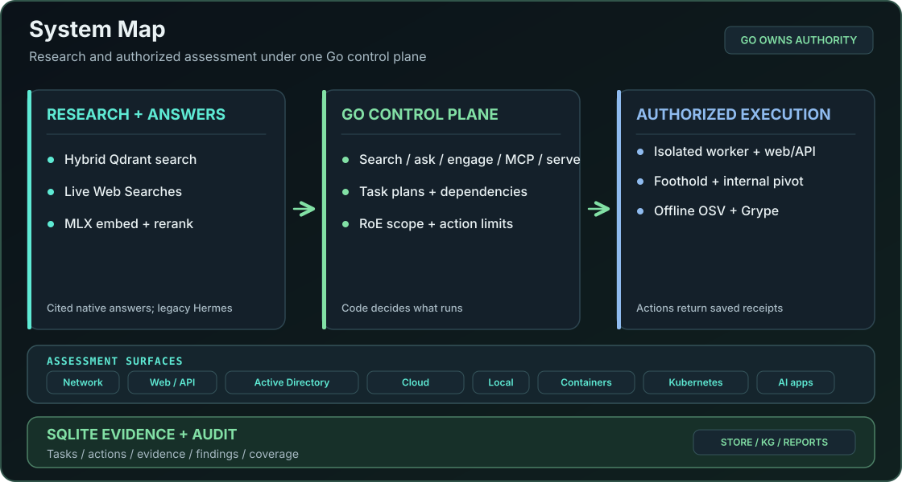
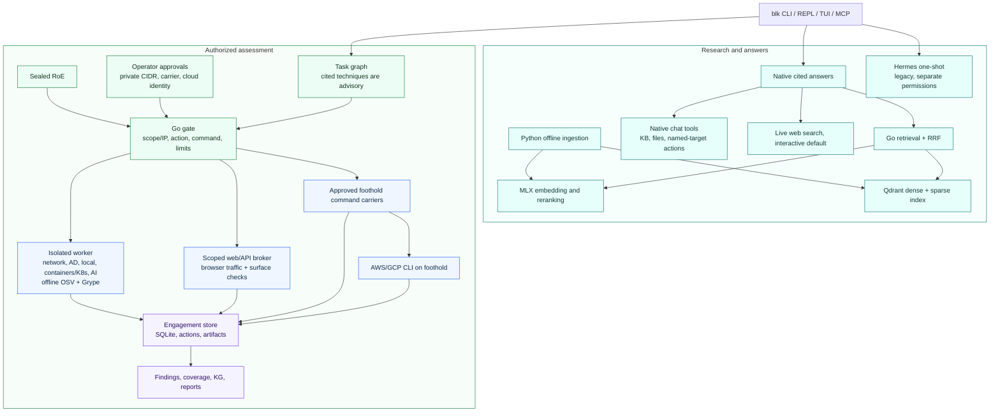

# Architecture

This document is for people changing blkChain. For installing and running it, see the README.

## System Map



### Runtime flow

Research citations inform candidate techniques but never authorize an action. The Go gate uses the
sealed RoE and separate operator approvals.

Interactive web-first search uses the current question only. Detected target details and
target-specific advisor turns stay local.

Native chat is the default for `blk ask`, REPL, TUI, and the `chat` tool of `blk mcp`. They are thin
adapters over one turn function, `runNativeTurn` in `cli/nativeturn.go`. It resolves the session,
loads its history, assembles the answer options once, calls the router, records tool actions, and
persists the turn, so routing, tools, and persistence are the same on every surface. It uses one
tool registry across those interfaces. The user-named target in the current
conversation supplies a temporary scope for isolated commands and web actions. This path has no
RoE file. `blk engage` keeps its sealed RoE gate, task state, and operator approvals.



Dynamically attached footholds require recorded access evidence. Only SSH and command carriers
provide the TCP stream used by the internal web broker.

## The language boundary

Go is the single implementation for search, ask, health, and MCP. The `blk` binary owns retrieval
orchestration (Qdrant over gRPC plus the embedding server) and the bounded answer loop in
`cli/rag.go`.

Python serves the MLX models (`blkchain/embed_server.py`) and builds the index offline
(`ingest.py`, `index.py`, `add.py`, reached through `blk add`). Python has no query-time code: there
is no Python search, answer, HTTP API, or MCP server. Do not add one.

## Repository layout

| Path | Contents |
| --- | --- |
| `cli/` | The `blk` terminal client: retrieval, the answer loop, the engagement harness, policy enforcement, web analysis, storage, reports, and the MCP server. |
| `cli/internal/` | Packages the binary shares: `secgate` (the command gate), `engagement` (the store), `histstore` (conversation memory and the session listing), `ragconfig` (the parameter contract), `retrieval` (the Qdrant and embedding clients), and the web analysis packages. |
| `cli/runner/` | The isolated runner image: `Dockerfile`, the `execute.py` launcher, and the package locks. |
| `blkchain/` | The MLX embedding and reranking service, offline indexing, and the evaluation harness. |
| `blkchain/contract/rag.json` | The RAG parameter contract both languages read. |
| `tests/` | Python unit tests. |

Models and corpus live outside the repository and are ignored by git. Nothing here bundles model
weights or corpus data.

## The cross-language contracts

Two contracts are load-bearing. Both must stay stable and in lockstep across Go and Python.

### The embedding server wire contract

`embed_server` is the only Python HTTP server. The Go client (`cli/internal/retrieval`) and
`index.py` consume it.

```
GET  /health  -> {"status": "ok", "embedder": true, "reranker": bool}
POST /embed   {"texts": [str]} -> {"embeddings": [[float]], "dim": int}
POST /rerank  {"query": str, "documents": [str]} -> {"scores": [float]}
```

Rules:

- Responses must be strict, spec-valid JSON. Python's `json.dumps` emits bare `NaN`, `Infinity`, and
  `-Infinity` by default, which strict parsers such as Go's `encoding/json` reject.
  `httputil.send_json` sanitizes non-finite floats to `null` and passes `allow_nan=False`. A
  non-finite score anywhere in a payload must not corrupt the whole response.
- Request bodies are bounded. `httputil.read_json_body` parses Content-Length defensively, rejects
  an oversized body with 413 before allocating, and returns 400 on malformed JSON.
- A 500 never returns the exception type or message. Use
  `httputil.send_error(handler, code, public_message, exc=e)`, which logs the detail to stderr and
  sends only the generic message.
- Do not change field names or shapes without updating the Go client in the same commit.

### The RAG parameter contract

`blkchain/contract/rag.json` holds the parameters shared across languages: `top_k`, `pool_size`,
`max_loops`, the answer and grade token and chunk caps, the temperatures, the answer sampling
settings, the default, router and assessment model ids, the dense and sparse vector names, the sparse model, the Qdrant gRPC URL, the embedding
server URL, and the reputable-domain and proof-of-concept domain lists.

The Go client loads it through `cli/internal/ragconfig` with precedence environment, then
`rag.json`, then a compiled-in fallback. The fallback must match `rag.json` byte for byte;
`TestBuiltinDefaultsMatchContractFile` enforces that, so a standalone `blk` binary behaves the same
as one run from the repository. When you change a value in `rag.json`, update `builtinDefaults()` in
the same commit or that test fails.

Python does not read `rag.json`. It keeps its own copies of the few shared values it still needs for
indexing: `SPARSE_MODEL`, the dense and sparse vector names, and the embedding server URL, all in
`config.py`. No test checks that they agree with `rag.json`, so change the matching Python constant
in the same commit.

A turn makes two kinds of model call. `router_model` answers action classification, routing, the
corpus check, context grading and conversation compression. `assessment_model` answers the direct
answer, the tool loop and grounded synthesis. `BLKCHAIN_ROUTER_MODEL` and
`BLKCHAIN_ASSESSMENT_MODEL` override the file. An empty value uses the model the turn would otherwise
resolve: `OMLX_MODEL`, else the first model the server lists, else `default_model`. An install that
sets neither therefore runs as one model. When no model resolves, each role uses the other role's
configured model.

A role's chain is its configured model, then the resolved model. A call advances the chain on a
transport failure, a timeout, an HTTP 5xx or a context-window rejection, and on nothing else: a
cancellation and any other HTTP status return as they are, and no further model is tried once the
turn's context has ended. A streamed answer does not advance once a byte has reached the reader, so a
partial answer is never followed by a second one. A model named with `/model` in the TUI is the whole
chain for both roles, because a turn reports the model that answered it.

A tool loop that fails over restarts from its first message. A call with the same tool and arguments
as one that already ran without error is answered from the turn's record instead of running again, so
an identical call with a side effect runs once for the turn, while a call the next model reformulates
runs. The record also carries the turn's tool-call count, so the call cap bounds every attempt
together rather than each attempt. The record holds at most 64 calls and 4 MiB of results,
so a call past either bound runs again on a restart. A call that returned an error is not recorded,
and two identical calls within one attempt both run. The record lives for one turn in one process and
is never consulted on a later turn. Only the native chat tool loop keeps it.

### The command output contracts

The JSON that `blk` prints is produced by Go. The evaluation harness parses it, so these shapes are
a contract too.

- `blk search --json`: `{"results": [{"id", "score", "payload": {source, path, section, type, text,
  cwe_class, origin?}}]}`. `origin` is the indexer's provenance tag, present only on content that
  `blk add <url>` fetched, so it is read when present rather than required. The answer path treats
  any non-empty origin as external, so a tag added later cannot default to trusted.
- `blk ask --json`: `--agent` is optional, and without it the turn selects the specialist itself. The
  payload carries the answer, citations, the web-use flag, the model, the agent, the session id for
  a `--session` turn, per-call LLM metrics, and the results. `untrusted` is true on a web citation
  and omitted on a local one.
- `blk sources --json`: the collection, the total chunk count, and per-source counts, sorted by
  count descending then name. It reads one Qdrant facet, so it is read-only.
- `blk health --json`: `{"ok": bool, "qdrant": bool, "embed_server": bool, "llm": bool}`. `ok` is
  true only when all three are up, and the command exits 1 when any is down.

Every payload carries `cwe_class`, as `""` when the indexed chunk has no concept tag.

## Security invariants

Do not weaken these.

### Authorization and operator safety

`blk engage` is an autonomous assessment tool. The operator's authorization is the premise for
target testing; the active engagement's rules of engagement define the allowed targets, actions,
time window, and rate. When the policy authorizes active or state-changing testing, the tool may
perform it autonomously within those bounds. Per-action human confirmation is not a universal
security control. Require an operator decision when the policy does not authorize an action or when
its bounds are ambiguous.

Normal native chat has a separate action path. It builds a bounded per-turn scope from IPs,
hostnames, networks, and URLs named by the user, never from model output or retrieved material.
Its command tool uses the audited binary list and the isolated executor; its web tools use the
broker's destination and redirect checks. It reads no RoE policy. A missing target exposes no
active tools, and the project's explicit binary denials still apply. This path does not alter
`blk engage` authorization. Native chat classifies action intent without fixed request phrases.
A requested target action, file read, or named research tool gets one retry when the model returns
text without the relevant tool call; a second such response fails the turn. A target action with
no user-named target fails before execution.

General file and terminal tools default to a persistent project-specific Docker sandbox with an
empty initial workspace and no network access. The operator explicitly selects local file and
terminal access with `--tool-host local` or `/tool-host local`. File imports and exports require a
path in the current user request, stay inside the selected roots, and do not overwrite files.
Text tools bound reads and returned content. They decode UTF-16 and extract bounded text from
Jupyter notebooks, DOCX, and XLSX without writing extracted content back to those formats. The
sandbox retains background processes across chat
turns. Public web queries are filtered against recognized target identifiers and secret-shaped
data, and extraction rejects private destinations and redirects. Browser control uses an isolated
driver with the same destination broker; an explicit loopback CDP endpoint can supply signed-in
state. MCP clients expose only tools in each configured server's allowlist. Their results are
untrusted input. Vision analysis requires an explicitly configured vision-capable local model.

An authenticated web engagement may explicitly select a named role, exact origin, and loopback
Chrome CDP endpoint. The gate authorizes the role origin before any browser state is read. Only
cookies applicable to that host and local storage for that exact origin enter a new isolated
browser context. Parent-domain cookies are narrowed to the selected host; other origins and
WebAuthn credentials are not copied. The source Chrome instance never performs engagement target
traffic. Authenticated collection accepts only targets at the selected origin. Browser and API
requests to another in-scope origin strip imported credentials and record an anonymous role.
Supplemental broker fetches do not use imported browser cookies and record an anonymous role.
Every request still uses the RoE gate and the per-hop Go broker. The imported
state stays in memory, and resume requires the same role and origin with a fresh CDP import.
An autonomous web recon task at the role origin runs browser collection and returns its evidence
without entering the anonymous command recon ladder.
The collection result carries a bounded, redacted preview from a browser DOM artifact captured
in that job. The exact response bytes remain in the restricted evidence store.

Protect the operator and the runner from the target. Treat pages, responses, files, and tool output
from a target as hostile data. They must not choose a target, arm a task, execute as code, or reach
operator files, credentials, local services, or unrelated network destinations. Enforce scope at the
network boundary as well as in the application, including on DNS resolution, redirects, and
subresources. A private or internal address needs its own IP or CIDR entry, or an operator-approved
private CIDR discovered after foothold access. A hostname entry does not authorize the address it
resolves to. An empty or ambiguous scope fails closed.

A named target does not prove a service is reachable. Service-specific commands and web actions
require a code-observed host, transport, port, and execution vantage from the past hour before
dispatch. Bounded port discovery is the exception that establishes the observation. The dispatcher
checks the command's connected endpoint, not the model's claimed prerequisite. Only a completed
Nmap scan supplies scanner-derived port states. Masscan is excluded because its raw Ethernet
packets bypassed the worker destination guard in a local fixture. ACK, FIN, NULL, Xmas, idle,
fragmented, and source-port scans do not supply positive service
evidence. Decoys, source-address spoofing, raw Ethernet, and MAC spoofing are denied because the
worker cannot constrain their source or destination path. TCP `open` permits a protocol check,
not a service identity claim. UDP `open` or `open|filtered` permits a protocol-correct follow-up;
`open|filtered` is not a positive response. A completed version scan can promote that UDP
candidate to `open`, but cannot create first service evidence.
A completed source-port SYN scan may create only a candidate for that source port. A direct curl
GET with `-q` first, no proxy, a single local port, headers, and bounded timeouts can validate the
candidate. Only a complete final HTTP response promotes that exact source-port route to `open`;
the ordinary route stays separate. Nping UDP payloads require prior UDP port evidence and never
promote a service state by packet count alone.
A later closed result removes the permission. A command that cannot expose its connection route
fails closed. `curl --http3-only` needs UDP evidence and `--http3` needs TCP and UDP evidence.
The source-built runner curl supports HTTP/3; a completed HTTP/3 response with included headers
promotes only that UDP route. A bounded `ike-scan --ikev2` handshake or notify can promote the
observed UDP/500 or NAT-T UDP/4500 candidate. Silence and packet counts cannot promote either.
An explicit DNS server needs evidence for both UDP and its possible TCP retry unless `dig +ignore`
keeps it on UDP. DoT and DoH use TCP/853 and TCP/443 by default; `dig +trace` is denied because
later name servers cannot be verified before dispatch.
The single-address `curl --resolve` form checks both the named host and connected IP against scope
while retaining the URL host for Host and SNI. The engagement store ties observations to command
output, execution vantage, and observation time across resume. Native chat holds observations for
one turn. A web action with no observation performs a scoped TCP connect before application data.
A loopback proxy CONNECT is an alternate observation; it does not authorize the worker or web
broker path.
Nmap SCTP and IP-protocol scans remain diagnostic and never create TCP or UDP port permission.
The pinned runner permits single-host `nmap -sn` discovery and bounded Nping packet comparisons.
Nping accepts one literal IP, at most three rounds at one packet per second, one TCP or UDP port,
and at most 512 hex payload bytes in UDP mode. Its raw modes run with `NET_RAW` after the native
chat firewall is installed, or in the engagement raw worker. Nping output never creates service
permission. Completed scanner forms are recorded with the full argv and vantage, and an exact
repeat is denied for one hour. Firewall diagnostic scans require a completed ordinary same-vantage
port baseline. The runner builds a checksum-pinned `ike-scan` and HTTP/3-capable curl. Large port ranges must be
partitioned into scans that finish within the command timeout; no partial result proves a full
inventory.
This service check adds to the RoE and network scope controls; it does not expand either one.
Network recon coverage uses the authorized command and its completed output. TCP and UDP sweeps
are separate dimensions; a version scan and a default-script scan cover their own dimensions.
Recorded prose or an incomplete scan cannot mark them complete. Without a current open or
`open|filtered` port on a literal IP, version and script checks are audited as not applicable.
An alternate source-port candidate still reaches the protocol-validation tier.
Explicit local terminal actions and configured MCP server tools are separate execution paths and
do not inherit this built-in target tool service check.

The declared foothold is the one deliberate exception to the network half, and it is bounded. A
command carried to an operator-declared foothold runs on a host whose egress is not ours to filter,
so its scope is enforced by the command gate alone. SSH, command, and HTTP form carriers run inside
the guarded worker, whose firewall pins the foothold address. Raw shells use a local loopback broker,
and Metasploit RPC uses a local loopback service. Every foothold address must be in scope. The
declaration is sealed into the policy so a resume with a different foothold is refused, the surface
of a task decides whether it pivots so no model or corpus text can move execution, and every pivoted
action records its destination. Approved private CIDRs are held separately from the sealed RoE and
apply only to foothold-covered surfaces. They do not expand the worker's direct network guard. On
the web surface, the host-side broker validates every request and redirect against the pivot scope,
resolves hostnames through the foothold, and dials the checked IP through the carrier. Exploit output
alone cannot advance an external vantage to an internal
foothold. An operator may attach a carrier to an evidenced armed exploit task after approving its
private network. Resume validates the attachment, pins its IP in the guard, probes execution through
the carrier, and only then advances the vantage. SSH and command carriers may cover the web surface.
Raw, Metasploit RPC, and HTTP form carriers cover command surfaces only. A raw shell attachment uses
a private workspace record and a separate loopback broker process. It retains one POSIX shell across
stop and resume until the engagement wall budget expires. Metasploit RPC uses a loopback MessagePack
service, checks the session peer against the approved foothold IP, and reads one command-shell
session with a sequence pointer. The HTTP form carrier sends a bounded POST through the guarded
worker to the approved IP and requires a command receipt. These three carriers do not provide the
binary TCP stream used by the web broker. One consequence runs the other way:
this host's PATH and symlinks describe this host, so a check that establishes a file's identity by
resolving a path cannot speak for a file on the foothold. Such a check compares lexically for a
pivoted command and fails closed
on a spelling it cannot resolve. Do not widen this exception to a destination the operator did not
declare.

AWS and GCP provider CLI commands require a separate operator approval tied to engagement evidence
and a credential file path on a foothold that covers the matching cloud surface. The approval does
not copy secret bytes into the workspace. The command gate authorizes the provider command before
the carrier adds a clean environment and the credential file override. The runner cannot verify the file's contents or
identity on the remote host; the operator approves that source and the RoE governs its use.

Bound requests, output, rate, duration, and total work, and provide a reliable operator stop
control. Credential use must not leak through logs or unrelated requests. An operator-approved
cloud credential source permits provider operations under the RoE action and task gates. Recon
accepts only audited read-only forms; other operations require an armed exploit or post-ex task.
The CLI cannot prove that every provider operation stays in one account or project.

External-surface sweeps run from the code-owned queue when a recon task names an HTTP origin. TLS,
header, cookie, CORS, method, metadata-path, and captured-material subdomain observations cite
their own evidence. A failed probe records a gap; derived names do not expand scope. The host-side
broker and the isolated command worker have different network vantage points, so one cannot infer
the other's reachability from its own response.

### Specific controls

- The SSRF guard in `index.py` for `blk add <url>` resolves and validates the host once, rejects
  private, loopback, link-local, reserved, multicast, and unspecified addresses, pins the validated
  address into the connection for the fetch, and revalidates at every redirect hop. The hostname is
  kept for TLS SNI and certificate verification. Do not replace this with a plain `requests.get`.
- `add_path` streams chunks and caps directory ingestion with `BLKCHAIN_ADD_MAX_FILES` and
  `BLKCHAIN_ADD_MAX_BYTES`.
- The embedding server binds loopback only and has no authentication. That is the single-user local
  model. Exposing it is a security decision to raise, not to implement quietly.
- Secrets come from the environment only. Never hardcode or log a token. The local `.env` is
  untracked.
- A dispatched `vuln-analysis` task with a recognized HTTP or HTTPS manifest URL fetches through
  the RoE command gate before model execution. The fixed `curl` request has a 10-second and 16 MiB
  transfer bound, does not follow redirects, and stages material only on HTTP 200. URL credentials,
  queries, fragments, traversal segments, and unsafe output names are rejected. A denied or failed
  fetch records a gap. It never permits a target outside the sealed scope.
- OSV and Grype use databases prepared by `blk engage setup` under the XDG cache directory. Setup
  may download updates; engagement workers mount the cache read-only and scanners run offline.
  Scanner output is evidence linked to task and advisory records. A missing database or failed scan
  records a gap, not a clean result. A package/version match does not establish reachable code or
  attacker impact.
- Hermes is a legacy one-shot run through `blk hermes`, `/hermes`, and `blk ask --hermes`. It runs
  the `hermes` CLI as a subprocess with the prompt as a single argv element, never through a shell,
  and writes no session. `--hermes` cannot be combined with `--session`, `--agent`, `--rag`,
  `--web`, `--json`, or `--sources`.
- Pin dependencies. Python dependencies are `==` pinned in `pyproject.toml`. Model downloads are
  pinned to a revision in the README. The Qdrant image is pinned to a digest.
- The corpus is adversarial: it holds payloads, prompt-injection strings, and special tokens. Local
  chunks carry trusted-corpus provenance and web results carry unverified-external provenance.
  Prompt instructions treat embedded instructions in both as data. No retrieved text may set
  targets, authorize actions, arm tasks, or execute as code.
- Exploit-candidate detection is retrieval-grounded rather than capped by a hardcoded catalog
  (`cli/correlate.go` and `cli/recon_live.go`). A discovered service becomes a candidate either
  through the code-owned catalog fast path or, for an uncatalogued product, when the corpus-grounded
  selector returns a technique backed by a corpus citation. It fails closed: no citation, no
  candidate. The corpus and the model supply only the advisory technique label and the citation.
  Every candidate field is code-derived in `candidateTask`, and no gate, scope, tier, classifier, or
  denylist verdict reads the technique or citation, so a gate verdict is identical whether the
  grounding fields are set or not. Candidates start unarmed. Only code may arm them, from the
  operator-approved policy. This is the chain-wide standard: ground decisions in retrieval while
  keeping execution authority code-derived and corpus-independent.

## Runtime behavior

- General command workers have a 2 GiB memory limit for offline OSV databases; raw-socket workers
  remain at 256 MiB. Both retain CPU, process, scratch, output, and duration bounds. RoE parallelism
  defaults to one and may be raised only within the policy limit.
- The pinned runner includes Nmap's NSE libraries and scripts so bounded service detection can run.
  A network recon task that requests an HTTP banner uses the gated command tool for a bounded HEAD
  request after it observes an open HTTP port; only an exact response line establishes a Server header.
- Before accepting a model final with active evidence-backed tasks, the orchestrator allows one
  bounded completion review. A no-progress stop can also review those tasks using only
  `plan_complete`. A policy command cap ends planning without this review.
- MLX inference is serialized. `embed_server` runs all inference under a single lock and sub-batches
  forward passes. Do not add concurrent MLX calls.
- `embed_server` releases the Metal cache after large index-time batches. Do not clear the LLM cache
  per request; its prefix and key-value cache speed up repeated answer-loop prompts.
- The evaluation judge degrades rather than crashing when the LLM returns an error. A failed `blk`
  call in the harness is recorded against its case and reported, never fatal. Keep the timeout and
  the stdout cap.

## Indexing behavior

- A chunk id is deterministic: the first 128 bits of the chunk sha256, folded into a UUID.
- Each chunk carries a `content_hash` in its payload. Re-indexing skips unchanged chunks, re-embeds
  changed ones by overwriting the same id, and inserts new ones.
- Changing the stored `path` format changes chunk ids, so a path-scheme change needs a clean rebuild.
  Drop the collection first or you get duplicate points.

## Sessions and conversation memory

A session is one append-only JSONL transcript under the blk data directory. The listing the resume
and history pickers read is a row per session in the history database, so a picker does not open
every transcript.

The sessions directory is shared by every blk process, so these writes are cross-process. A turn
appends its transcript lines and then commits the memory rows together with the transcript length
they account for, in one transaction. That transaction is the turn's only commit point: bytes past
the committed watermark belong to a turn that never committed, and the reader reconciles them away
when the session is next opened. A listing row with no watermark recorded means the length is
unknown, and then the whole transcript counts as committed and is never truncated.

## Testing

Run the Python suite before claiming anything works. It uses the standard library `unittest`
runner; pytest is not a project dependency. Sync the virtual environment first, or the modules that
import the engine fail with `ModuleNotFoundError`.

```sh
.venv/bin/python -m unittest discover tests
```

Go tests are `cd cli && go test ./...`, and `cd cli && go test -race ./...` for the race detector,
which CI runs as its own job because the harness fans out worker pools per task and the session
store is written by several processes.

The Python static check is `uvx ruff check blkchain tests`. Its rule selection lives in
`pyproject.toml`: `E501` is ignored because its findings disagree with the project's wrap width
rather than naming a defect, and ruff's formatter is not adopted. Every analyzer CI runs is pinned
in the workflow that runs it. Nothing updates a version inside a `go run` or `uvx` argument, so
those pins move by hand.

The default suites are hermetic. Opt-in browser, runner, MCP, and local-model integration tests
require provisioned services or containers and are gated behind environment variables. Add a
regression test with every fix, in the file that matches its area.
The default scanner tests check routing, authorization, parsing, and persistence with fixtures.
A live scan also needs the runner image, a complete local database cache, and a controlled target;
passing fixture tests alone does not prove that those external dependencies are ready.

## Evaluation

```sh
(cd cli && go build -o blk .)
export BLK_BIN="$PWD/cli/blk"
.venv/bin/python -m blkchain.eval.run --no-judge
```

The harness runs `blk search --json` per case, and `blk ask --json` for the judge, so Qdrant and
`embed_server` must be running. Retrieval labels match bounded terms in result text, with optional
source and CWE constraints. Two unrelated queries check for false hits against the DOM XSS and JWT
cases. The run reports hit rates, reciprocal rank, and negative-control false hits.

## Coding standards

- State assumptions. If two readings of a task exist, surface both.
- Simplicity first: the minimum code that solves the problem. No speculative abstractions, no
  configuration for fixed values, no error handling for impossible states.
- Surgical changes. Touch only what the task needs and match the surrounding style. Remove the
  imports and names your own change orphaned, and nothing else.
- Turn a task into a verifiable check and prove it by running the command.
- Prose and comments read as if a human wrote them: plain ASCII punctuation, direct and concise.
- Comments are minimal and factual. A comment states what the code does, or why a non-obvious
  choice is necessary, in plain present tense. If the code already says it, delete the comment.
  Objective identifiers that describe a real contract stay: protocol version strings, spec ids such
  as WSTG and CWE, CVE ids, RFC numbers, and algorithm names.
- Validate untrusted input at the boundary, bound every resource, keep secrets in the environment,
  and pin dependencies.

## Commit conventions

Conventional Commits (`feat:`, `fix:`, `docs:`, `refactor:`, `test:`, plus a scope such as
`config:` or `eval:`). Stage files explicitly by path.

## Gotchas

- Non-finite floats break strict JSON clients. Keep responses strict JSON.
- A model swap that changes the embedding dimension needs a new collection. The default embedder is
  1024-dimensional and drop-in; a 768-dimensional model is not.
- The 4-bit DWQ embedder emits bfloat16, so the float32 cast in `embed_server` is required.
- After a path-scheme change, rebuild the index from a clean collection or you get duplicate points.
- Building the full index re-embeds many chunks and takes real time. Run it in the background and
  watch the collection point count.
